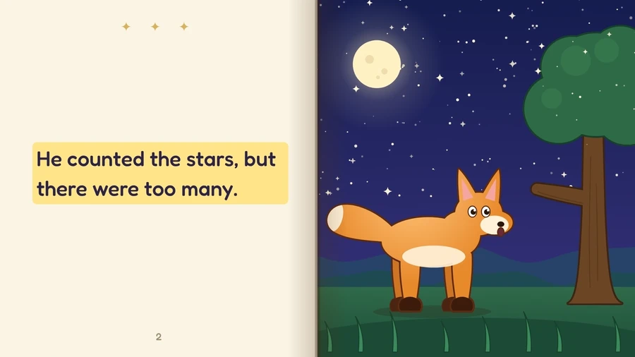
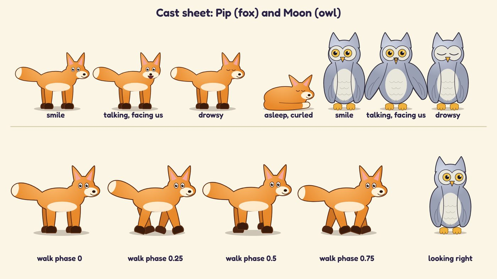
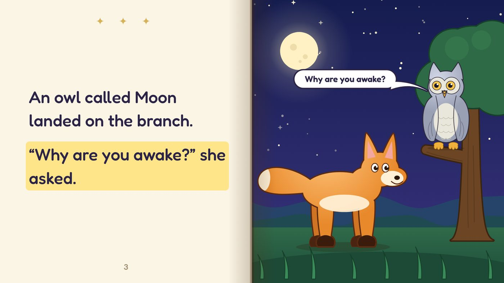
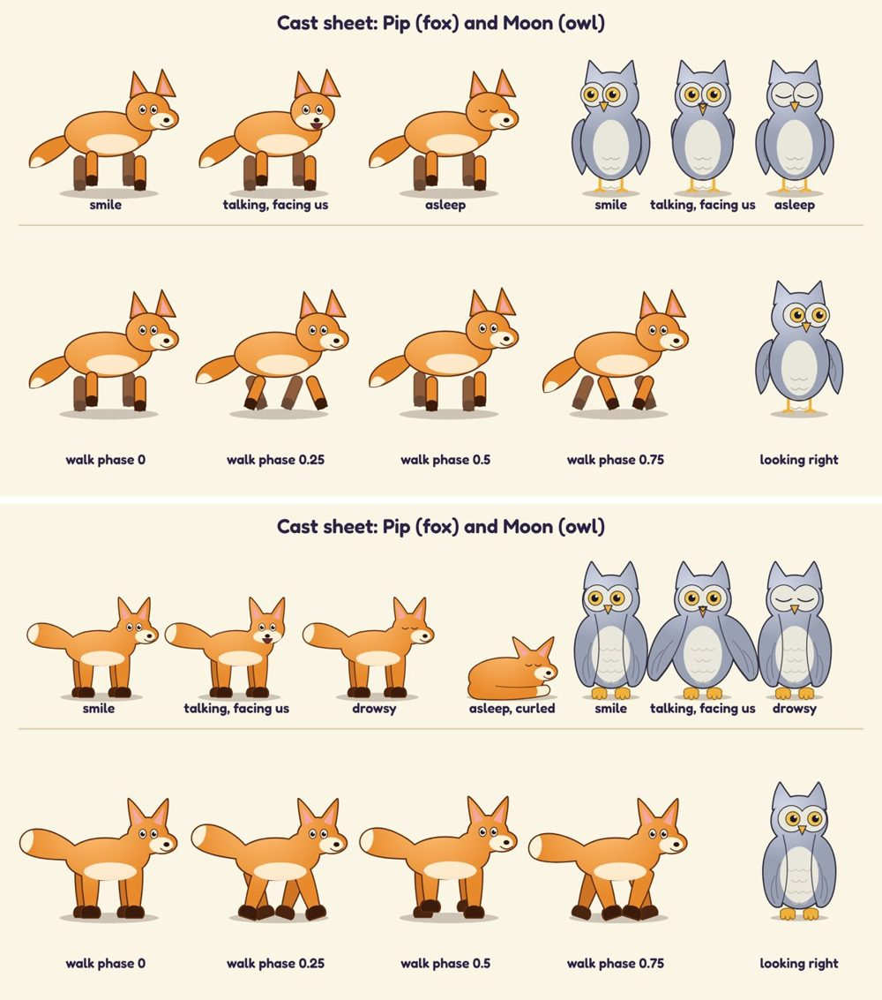
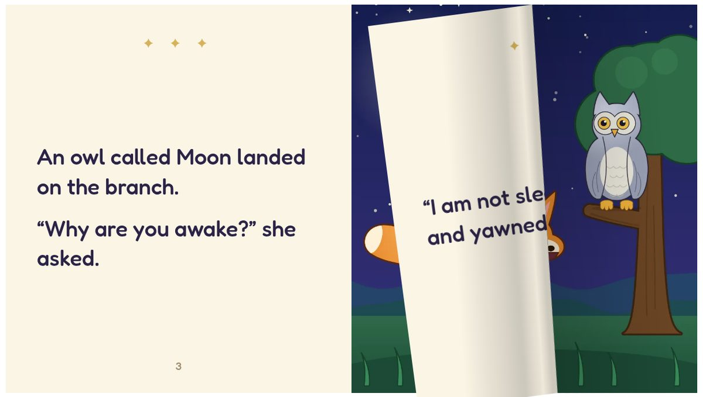

# bedtime-storybook-kit

**Turn a bedtime story you told out loud into a read-along picture book, with your own characters.**

<p align="center">
  
</p>

You record a story at bedtime on your phone. This kit turns it into a video book: your voice
reads it, the sentence you are saying lights up so an early reader can follow along, and the page
turns when the story moves on. The pictures are drawn in code, so the same characters can come
back in the next story. There is also an optional flip book for the web.

It is written for an AI coding agent. Put your recording in `recordings/`, point your agent at
this repository and say:

> Follow RECIPE.md to make a read-along picture book from my recording `recordings/story.m4a`,
> with my own characters.

The agent asks who told the story, who was listening and what the characters look like, then
works through the recipe. A short made-up story, *The Fox Who Could Not Sleep*, is included so
you can see every step work before you use a real recording. Every picture on this page comes
from it.

## How it works

**1. Save the recording first, properly.** Before any drawing, the story's details are written
*into the audio file*: title, date, who told it and to whom, a summary, the full transcript with
timestamps, and a cover picture. Then the whole file is decoded to prove it still plays. Even if
you never make the book, the recording now describes itself, the way a podcast episode does.

**2. Transcribe it.** [Whisper](https://github.com/SYSTRAN/faster-whisper) turns the recording
into words with timings. You check the transcript by ear: names and odd lines get misheard.

**3. Keep the words as told.** The page text is the storyteller's own words, one sentence per
line, timed to the audio. The listener's questions and the storyteller's stumbles come off the
page; nothing is rewritten "for reading level".

**4. Build the cast once, from parts.** Each character is drawn in code as separate parts that
move on their own (eyes that blink, a mouth that talks, a tail, legs that walk), and checked on a
cast sheet before any scene is drawn. The next story starts with everyone already made.

<p align="center">
  
</p>

**5. Draw the scenes.** One picture per page, with the text page beside it. Speech bubbles
appear as the words are spoken and keep clear of every face.

<p align="center">
  
</p>

**6. Review the art.** Drawing in code drifts: legs that do not quite meet the body, a face that
slides off its head, a bubble over someone's ears. `prompts/art-review.md` is a ready-made brief
for the most capable model you have: it goes over every drawing, page by page, and fixes what it
finds. Here is what one pass did to the example cast (before above, after below):

<p align="center">
  
</p>

**7. Render the video** with [Remotion](https://www.remotion.dev): stills first, then a short
clip watched at normal speed, then the whole book.

**8. Finish it**: a standard video file with captions, a chapter per page, cover art and tags,
ready for a TV, a phone or a photo library.

**9. Optional: a web flip book** with real text pages you can turn by hand.

<p align="center">
  
</p>

The full detail, including the lessons learned the hard way, is in [`RECIPE.md`](RECIPE.md).

## Try the example

You need Node 18+, Python 3.9+ and [ffmpeg](https://ffmpeg.org). To hear the example read aloud,
also install [Piper](https://github.com/OHF-Voice/piper1-gpl), a free text-to-speech program that
runs on your own computer, and one voice. Without it the example uses espeak-ng if you have it,
or a beep per sentence.

```bash
python3 -m venv ~/.venvs/tts && ~/.venvs/tts/bin/pip install piper-tts
~/.venvs/tts/bin/python -m piper.download_voices --download-dir ~/.cache/piper en_US-ljspeech-high
```

Then build the example book:

```bash
npm ci
python3 -I stories/example/make_audio.py --voice ~/.cache/piper/en_US-ljspeech-high.onnx \
  --piper ~/.venvs/tts/bin/piper --slow 1.1      # the narration and its word timings
python3 -I tools/time_pages.py stories/example   # when each sentence is spoken
npm run still:cast                               # out/cast.png, the cast sheet
npm run render:example                           # out/example.mp4, the book (under a minute)
python3 -I tools/finish_video.py stories/example out/example.mp4 "out/The Fox Who Could Not Sleep.mp4"
```

Everything you generate (audio, video, images) stays out of git; the repository holds code, text
and the pictures in `docs/`.

## What is in here

| Path | What it is |
|---|---|
| [`RECIPE.md`](RECIPE.md) | The steps your agent follows, in order |
| [`STYLE.md`](STYLE.md) | The look every drawing follows |
| [`prompts/art-review.md`](prompts/art-review.md) | The art review brief, ready to hand to an agent |
| `src/book/` | The book engine: spreads, page turns, the highlighted sentence, cover and last page |
| `src/kit/` | Shared drawing parts (`rig.tsx`), effects, speech bubbles and sound words, and the example's fox, owl and meadow |
| `src/sheets/` | The cast sheet, the example book and the flip-book stills |
| `stories/example/` | One story's folder: text, timings, the moments the room leaks in, and `BIBLE.md`, the plain-language record of every page |
| `tools/` | Tagging the recording, transcription, page timing, comparing transcripts, finishing the video |
| `web/` | The flip book builder |

## Which AI

Nothing here depends on a particular AI agent or AI model. The recipe and the prompts are written
for any coding agent that can read files, run commands and look at images. Where a step benefits
from a stronger model (the art review, drawing characters in code), it says so without naming
one, because AI model names date within months. The tools are named where they are used.

**What we used (October 2026):** Claude Code, with Anthropic's most capable model at the time
for the art review and the character drawing, and its everyday model for the rest.

## Licenses

- The kit's own code is MIT ([`LICENSE`](LICENSE)).
- **Remotion has its own license**: free for individuals, companies of up to 3 people and
  non-profits; larger companies need a company license from [remotion.pro](https://www.remotion.pro).
  The kit's MIT license does not cover it.
- StPageFlip (MIT) is included in `web/vendor/` with its license. Whisper, Piper and ffmpeg are
  installed by you and run as separate programs. Details in [`THIRD_PARTY.md`](THIRD_PARTY.md).

## A note on privacy

A recording of your family is personal. Recordings, transcripts and generated media are
git-ignored here; keep your own story folders and drawings of real people private unless you mean
to publish them.
